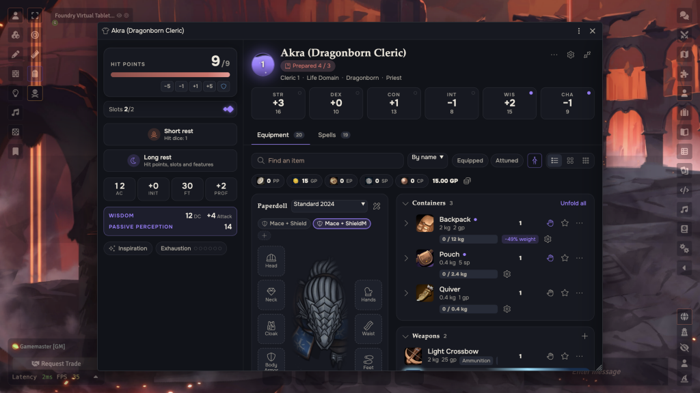
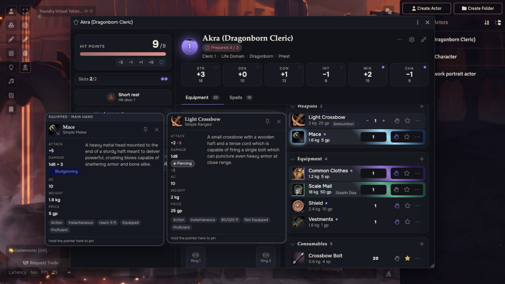
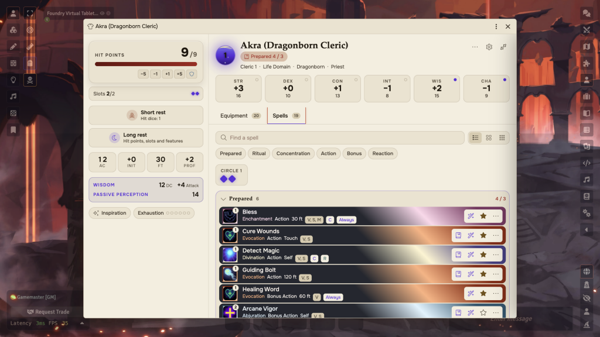

<div align="center">

**English** · [Русский](README.ru.md)

# AIM: Actor Window

**A character, NPC, and vehicle window for D&D 5e on Foundry VTT**

Paperdoll, equipment rules, loadouts, spells, features, effects, hover item comparisons, and player trading in a dedicated window alongside your actor sheet.

[](https://github.com/TacticalOtaku/actor-inventory-manager/releases/latest)
[](https://github.com/TacticalOtaku/actor-inventory-manager/actions/workflows/ci.yml)
[](https://foundryvtt.com/)
[](https://github.com/foundryvtt/dnd5e)
[](lang/)
[](LICENSE)

[Installation](#installation) · [Screenshots](#screenshots) · [Features](#features) · [Player Trading & Gifts](#player-trading--gifts) · [Integrations](#integrations) · [Customization](#customization) · [Development](#development)

</div>

---

## Installation

In Foundry VTT (Setup → Add-on Modules → Install Module), paste the Manifest URL:

```text
https://github.com/TacticalOtaku/actor-inventory-manager/releases/latest/download/module.json
```

Requirements: Foundry VTT 14 (verified on `14.367`), D&D 5e `5.3.3+`.  
Manual install: download `actor-inventory-manager-v<version>.zip` from [GitHub Releases](https://github.com/TacticalOtaku/actor-inventory-manager/releases/latest) and extract it into `Data/modules/actor-inventory-manager`.

> [!IMPORTANT]
> **Updating from 1.9:** back up your world first. On the first launch of 2.0+, the GM client runs an additive migration once (quick slots → favorites, custom actor dolls → world presets, open trades cancelled) and whispers a report to the GM. Nothing written by 1.9 is deleted, so worlds can still return to 1.9.x if needed.

---

## Screenshots





---

## Overview

AIM leaves the system or third-party sheet in place. When players open a supported actor, AIM opens by default instead of the standard sheet (configurable per client, without affecting the GM). You can also open it from the `AIM` entry in the sheet's `⋮` menu or with the `I` key, and the original sheet stays accessible via `"Open character sheet"` in AIM's `⋮` menu. Release notes live in [CHANGELOG.md](CHANGELOG.md).

---

## Features

### Adaptive actor window

- **Supported actors:** Characters, vehicles, and player-owned NPCs. GM-only NPCs and group actors stay on the default sheet.
- **Permissions and tokens:** Observers get a read-only `"View only"` window, while owners and the GM can edit. Unlinked tokens open independent windows keyed by UUID.
- **Player sheet redirect:** With `Open AIM instead of actor sheet` enabled (on by default), clicking a supported actor, double-clicking its token, or opening a `@UUID` link opens AIM directly for players. GM opens, `LIMITED` actors, groups, and GM NPCs bypass the redirect, and `"Open character sheet"` inside AIM's menu still opens the original sheet.
- **Width-based layouts:** The window switches layout from its own width: Compact (`< 420 px`, rail only), Narrow (`420–759 px`, top rail strip), Standard (`760–1319 px`, rail and content), and Wide (`≥ 1320 px`, adding the item inspector), with a collapse-to-column button in the header.
- **Keyboard navigation:** Press `I` to toggle the window for the controlled token or assigned character. `ArrowLeft`, `ArrowRight`, `Home`, and `End` move across tabs, keeping focus intact across drawer and compact layout changes.

### Side rail and inline vitals

- **Level orb and XP card:** An animated liquid orb glows as XP fills and triggers level-up when clicked at cap, paired with quick XP steps (`+50`, `+100`, `+250`, `+1000`, `Add`, `Set`).
- **Inline edits:** Change HP (`−7` damage, `+5` healing, `20` set, `t8` temporary HP), coins, and feature uses directly in place with syntax hints, `Enter`/`Escape` handling, and draft preservation during background redraws.
- **Combat and survival:** Armor class hover breakdown (armor, Dexterity, shield, bonuses, cover), hit dice, spell slot tracks, initiative, speed, temporary effects, inspiration, exhaustion, concentration, short/long rests, and reorderable dnd5e favorites.
- **NPC and vehicle rails:** NPCs display challenge rating and legendary action/resistance pools; vehicles show damage and mishap thresholds, speeds, cargo load, and crew, passenger, and draft-animal rosters.
- **Block visibility:** Every rail block except HP can be hidden or shown per user in the settings drawer.

### Paperdoll and equipment rules

- **9 built-in presets across 5 figures:** `Humanoid` (`Standard 2024`, `Standard 2014`), `Beast`, `Wagon` (`hold` and `tack & weapon`), `Ship` (`hold` and `gun ports`), and `Airship` (`hold` and `rigging`).
- **Slot mechanics:** Two-handed weapons lock the off hand automatically, attunement sockets enforce the actor's attunement cap, and worn items without a slot stay visible in a compact strip.
- **Equipment loadouts:** Save up to 12 named gear sets with custom icons (such as _Sword & Shield_, _Bow_, or _Camp_) and swap between them in one click under the active slot rules, leaving containers, natural weapons, and ammunition untouched.
- **GM preset editor:** Configure figures, slot placement (`Left`, `Right`, `Under the doll`, `By order`), slot rules, and attunement caps per world or per actor, with JSON import and export.
- **Shared enforcement modes:** Choose Strict Block, Smart Auto-Swap, or Warn Only in module settings. The same rules run in both AIM and the actor's native sheet.
- **Inventory management:** Switch between List, Cards, and Icons only views; sort by name, weight, price, rarity, or manual order; filter by `Equipped` or `Attuned`; organize nested containers, coin totals, and encumbrance meters; or use `"Drop on the ground"` when Item Piles is active.

### Window tabs

| Tab | Contents |
| --- | --- |
| Overview | Skills, saving throws, tools, damage and condition defenses, passive scores, senses, proficiencies, and native dnd5e config dialogs |
| Equipment | Paperdoll, attunement sockets, nested container trays, inventory views and filters, purse, encumbrance meter, and the Trade panel |
| Spells | Interactive spell slot gems, class preparation limits, spellbook by circle, innate and at-will lists, casting dialogs, and auto-minimize on spell template placement |
| Features / Actions | Features grouped by origin for characters; actions grouped by cost for NPCs and vehicles, with inline uses and d6 recharge rolls |
| Effects | dnd5e effect categories (`Temporary`, `Passive`, `Inactive`, `Unavailable`), conditions grid, switches, and context menu |
| Biography | Character traits, appearance, and ProseMirror biography fields kept safe from background redraws while typing |

### Tooltips, visual effects, and privacy

- **Nested, pinnable, and comparing cards:** Hover over items, spells, effects, rules, or damage types to inspect nested cards up to 4 levels deep, pin them, and drag them around the screen. Hovering an unequipped inventory item opens a side-by-side comparison against what is currently equipped in its target slot (with AC, attack, and average damage deltas), toggleable per user in Settings. Damage types render PixiJS scenes for all 13 dnd5e damage types plus a generic fallback.
- **Reactive and ambient VFX:** Sprite bursts and animations play on damage, healing, temporary HP, spent slots or hit dice, starred favorites, coin edits, rests, and rule refusals.
- **Unidentified item privacy:** Players cannot see an unidentified item's price, rarity, properties, charges, or magic bonuses in list rows, on the paperdoll, in the inspector, or inside tooltip cards.
- **External drops:** Items, folders, and effects dragged from the sidebar, compendiums, chat, journals, or your other characters route through the actor's sheet so dnd5e handles stacking, scroll conversion, and advancement rules.

---

## Player Trading & Gifts

Open your character's window, go to Equipment, and click `"Trade"`:

- **Two-way trade or one-way gift:** Pick another online player's character (`Offer trade` or `Give`). The invited player sees a notification and an indicator dot on their Trade button.
- **Adding items and coins:** Click `⇄` on an inventory row to offer one item, drag a row into your offer to add the whole stack, and enter coins (`pp`, `gp`, `ep`, `sp`, `cp`, or active Item Piles currencies). Edits send automatically after a short pause, and any change clears confirmations.
- **Weight after trade:** A live carried-weight preview shows how the exchange affects your encumbrance and highlights load-tier shifts.
- **Confirmed delivery:** Once both sides confirm (or the recipient accepts a gift), an active GM runs the transfer. Received items arrive unequipped, unattuned, detached from containers, and marked `New` until opened.

<details>
<summary><strong>Technical details: GM authorization, snapshots, and recovery</strong></summary>

- **GM-authorized queue:** Players never need ownership of each other's sheets. One connected GM serializes requests through authenticated `User` flags; no module socket payload authorizes writes.
- **Pre-trade snapshots and rollback:** Before any debit, the GM locks items and currency on both actors (HP, spell slots, and XP stay editable) and saves a full JSON snapshot in a GM-only private journal. Transfer errors automatically roll inventories and currencies back.
- **Interrupted trade recovery:** If a transfer or rollback is interrupted, the trade remains locked instead of retrying automatically. A GM can open either participant's Trade panel and choose `"Restore inventories"` (after checking the journal) or `"Lift the lock"` (if preparation stopped before any debit).
- **Non-transactional Foundry scope:** Foundry VTT has no multi-actor database transaction, so avoid running macros or editing participating inventories by hand during execution or recovery.

</details>

---

## Integrations

All integrations are optional and detected at runtime; without them, AIM relies on its built-in rules.

| Module | Compatibility | Integration behavior |
| --- | --- | --- |
| midi-qol | Optional | Hides automation-only activities from lists and favorites; routes inline HP damage through `dnd5e.preApplyDamage` |
| Tidy 5e Sheets | `5.3.x` line | Adds the `AIM` entry to Tidy's sheet menu and preserves native drop handling |
| Item Piles | `3.3.0+` _(with `itempilesdnd5e`)_ | Supports custom currencies and automatic change in trades, `"Give to character"`, and `"Drop on the ground"` |
| Weighty Containers | `3.5.0+` _(`3.10+` load rules)_ | Delegates container load meters, weight reductions, drop restrictions, and post-trade carried weight |
| SC - Item Rarity Colors | `3.0.18+` | Applies SC rarity gradients and spell-school colors while keeping row controls and Parchment tags readable |
| libWrapper | `1.12.0+` _(optional)_ | Uses a `MIXED` sheet-open wrapper to coexist with other sheet modules; falls back to direct prototype wrapping when absent |

---

## Customization

Window preferences live in the window's Settings drawer (`⚙`); GM rules live in Foundry's Module Settings.

| Setting | Options | Scope |
| --- | --- | --- |
| Theme | `Night` · `Parchment` · `Auto` _(follows Foundry's colour scheme)_ | User |
| Accent | `Brass` · `Embers` · `Arcane` · `Forest` · `Frost` · `Rose` | User |
| Density | `Comfortable` · `Compact` | User |
| Side column & Tabs | Toggle individual rail blocks and sheet tabs (`Equipment` always stays visible) | User |
| Motion | `All` · `Restrained` _(reactive only)_ · `Off` _(fades only; capped by OS reduced motion and Foundry low performance)_ | Client |
| Decorative fonts | Bundled Onest variable font (`assets/fonts/`, no external CDN requests) | Client |
| Equipment Rules & Doll | `Enforcement Mode` (`Block` / `Auto-Swap` / `Warn`), `Portrait Backdrop`, `Auto-Reconcile Slots`, `Open AIM instead of actor sheet`, `AIM in sheet menu` | World / Client |

---

## Development

Requires Node.js 24+ (`npm install`). Automated checks run on in-memory Foundry document doubles, so no running Foundry instance is needed.

| Command | Purpose |
| --- | --- |
| `npm run check` | Run ESLint and the Node unit test suite |
| `npm run deploy` | Copy module files to local Foundry `Data/modules/actor-inventory-manager` (`--data <path>` or `FOUNDRY_DATA`) |
| `npm run package` | Validate `module.json` and build `dist/actor-inventory-manager-v<version>.zip` |
| `npm run release` | Run `npm run check` and `npm run package` |
| `npm run vendor` | Refresh bundled Onest font files and `styles/theme/fonts.css` |

GitHub Actions ([ci.yml](.github/workflows/ci.yml)) runs linting, unit tests, and Foundry package validation on pushes to `main` and manual dispatches. Tagged releases (`v*`) build and publish the ZIP archive and `module.json` via [release.yml](.github/workflows/release.yml).

### Project docs

| Document | Purpose |
| --- | --- |
| [API.md](API.md) | Frozen public API, loadouts, equipment rule hooks, and macro examples |
| [docs/architecture.md](docs/architecture.md) | Module layering, dnd5e data-model adapters, extension hooks, and public API |
| [docs/live-check.md](docs/live-check.md) | Manual verification checklist across Foundry module combinations |
| [GLOSSARY.md](GLOSSARY.md) | Domain vocabulary |
| [CHANGELOG.md](CHANGELOG.md) | Version-by-version release notes |
| [CONTRIBUTING.md](CONTRIBUTING.md) | Issue reporting guidelines |

---

## AI Disclosure

AI-assisted tools were used during development for tasks such as code drafting, refactoring, tests, documentation, and localization drafts. All architecture, code, behavior, user-facing copy, and Russian/English translations are reviewed, tested, and maintained by TacticalOtaku, who retains sole authorship and responsibility for the module.

All bundled package assets and user-facing materials comply with Foundry VTT's [AI Content Policy](https://foundryvtt.com/article/ai-policy/); no pre-generated AI art, audio, or lore assets are included.

---

## Feedback & License

Pull Requests are disabled on this repository; bug reports and suggestions are welcome via [GitHub Issues](https://github.com/TacticalOtaku/actor-inventory-manager/issues) (see [CONTRIBUTING.md](CONTRIBUTING.md)).

Released under the GNU General Public License v3.0 ([LICENSE](LICENSE)). Bundled Onest font ([OFL-onest.txt](assets/fonts/OFL-onest.txt)), Kenney Particle Pack ([LICENSE-kenney-particle-pack.txt](assets/vfx/LICENSE-kenney-particle-pack.txt)), and `pixi-filters` ([LICENSE-pixi-filters.txt](scripts/vendor/LICENSE-pixi-filters.txt)) retain their respective notices.
