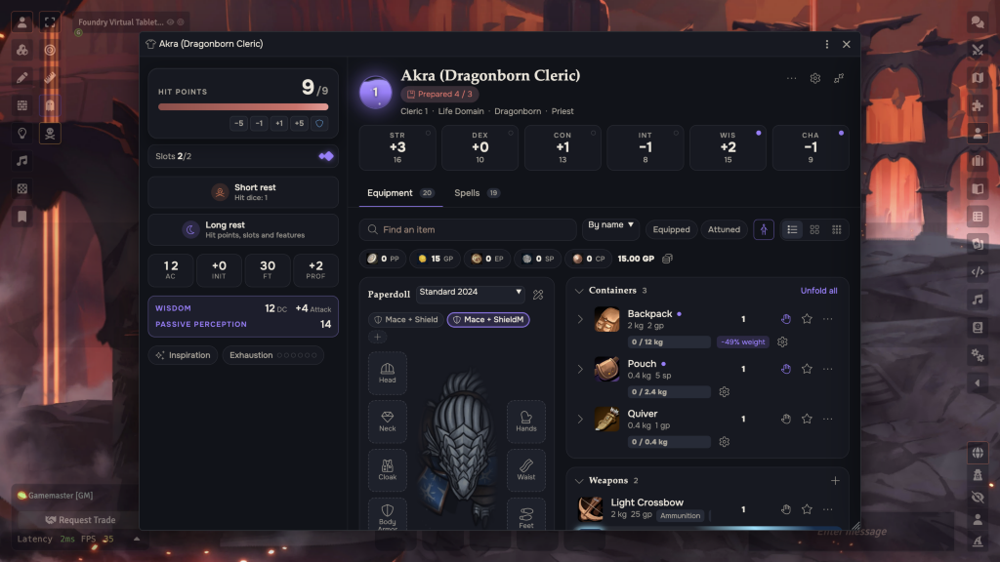
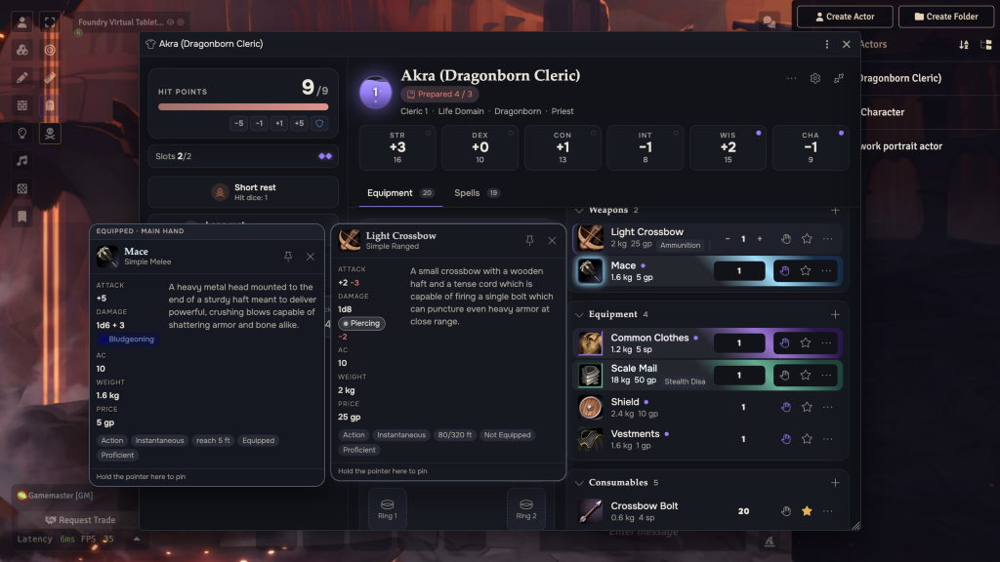
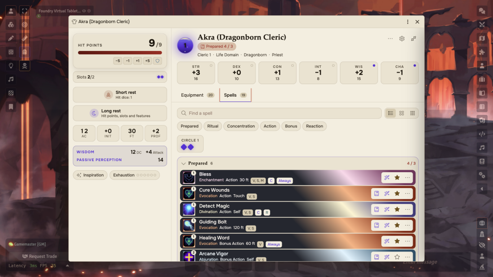

<div align="center">

[English](README.md) · **Русский**

# AIM: Actor Window

**Окно персонажа, НИП и транспорта для D&D 5e в Foundry VTT**

Кукла снаряжения, правила слотов, наборы экипировки, заклинания, умения, эффекты, сравнение предметов при наведении и обмен между игроками в отдельном окне рядом с листом актёра.

[](https://github.com/TacticalOtaku/actor-inventory-manager/releases/latest)
[](https://github.com/TacticalOtaku/actor-inventory-manager/actions/workflows/ci.yml)
[](https://foundryvtt.com/)
[](https://github.com/foundryvtt/dnd5e)
[](lang/)
[](LICENSE)

[Установка](#установка) · [Скриншоты](#скриншоты) · [Возможности](#возможности) · [Обмен и подарки](#обмен-и-подарки) · [Интеграции](#интеграции) · [Настройка](#настройка) · [Разработка](#разработка)

</div>

---

## Установка

Вставьте URL манифеста в окно установки модулей Foundry VTT (Дополнительные модули → Установить модуль → Manifest URL):

```text
https://github.com/TacticalOtaku/actor-inventory-manager/releases/latest/download/module.json
```

Требования: Foundry VTT 14 (проверено на `14.367`), D&D 5e `5.3.3+`.  
Ручная установка: скачайте `actor-inventory-manager-v<версия>.zip` со страницы [GitHub Releases](https://github.com/TacticalOtaku/actor-inventory-manager/releases/latest) и распакуйте в `Data/modules/actor-inventory-manager`.

> [!IMPORTANT]
> **Обновление с версии 1.9:** сначала сделайте резервную копию мира. При первом запуске 2.0+ клиент мастера один раз выполняет аддитивную миграцию (быстрые слоты → избранное, пользовательские куклы актёров → мировые пресеты, открытые обмены отменяются) и отправляет отчёт шёпотом мастеру. Данные 1.9 не удаляются, поэтому при необходимости мир можно вернуть на 1.9.x.

---

## Скриншоты





---

## Обзор

AIM не подменяет системный или сторонний лист персонажа. У игроков при открытии поддерживаемого актёра AIM запускается по умолчанию вместо обычного листа (это отключается в настройках клиента и никогда не затрагивает мастера). Окно также открывается по кнопке `AIM` в меню `⋮` листа и по клавише `I`, а стандартный лист остаётся в меню `⋮` самого AIM под пунктом «Открыть лист персонажа». История изменений ведётся в [CHANGELOG.md](CHANGELOG.md).

---

## Возможности

### Адаптивное окно актёра

- **Поддерживаемые актёры:** персонажи, транспорт и НИП, которыми владеют игроки. НИП мастера и групповые актёры открываются обычным листом.
- **Права и токены:** наблюдатели видят окно в режиме `«Только просмотр»`, владельцы и мастер могут редактировать его. Для несвязанных токенов создаются отдельные окна по UUID.
- **Открытие вместо листа:** если включена настройка «Открывать AIM вместо листа актора» (активна по умолчанию), клик по поддерживаемому актёру, двойной клик по токену или переход по `@UUID` сразу открывает AIM для игроков. Действия мастера, группы, НИП мастера и записи с уровнем `LIMITED` не перенаправляются, а пункт «Открыть лист персонажа» в меню AIM продолжает открывать штатный лист.
- **Режимы ширины:** окно меняет компоновку по собственной ширине: Компактный (`< 420 px`, только боковая колонка), Узкий (`от 420 до 759 px`, верхняя лента), Обычный (`от 760 до 1319 px`, колонка и вкладки) и Широкий (`≥ 1320 px`, добавляется панель инспектора). В заголовке есть кнопка быстрого сворачивания в колонку.
- **Клавиатура:** клавиша `I` открывает и закрывает окно выбранного токена или назначенного персонажа. Клавиши `ArrowLeft`, `ArrowRight`, `Home` и `End` переключают вкладки, сохраняя фокус при открытии настроек и смене режима ширины.

### Боковая колонка и быстрые правки

- **Сфера уровня и карточка опыта:** анимированная сфера с жидкостью светится по мере накопления опыта и повышает уровень кликом, когда опыт заполнен. Рядом в карточке доступны шаги XP (`+50`, `+100`, `+250`, `+1000`, `Добавить`, `Задать`).
- **Редактирование на месте:** меняйте ХП (`−7` урон, `+5` лечение, `20` задать, `в8` временное ХП), монеты и использования умений прямо в карточках. Поля подсказывают синтаксис, реагируют на `Enter` и `Escape` и не сбрасывают вводимый текст при фоновых перерисовках.
- **Бой и выживание:** разбор КД при наведении (доспех, Ловкость, щит, бонусы, укрытие), кости хитов, треки ячеек заклинаний, инициатива, скорость, временные эффекты, вдохновение, истощение, концентрация, короткий и продолжительный отдых, а также перетаскиваемое избранное dnd5e.
- **Колонки НИП и транспорта:** у НИП отображаются КО и запасы легендарных действий и сопротивлений; у транспорта показаны пороги урона и поломки, скорости, загрузка груза, списки экипажа, пассажиров и тягловых животных.
- **Видимость блоков:** любой блок боковой колонки (кроме ХП) скрывается и возвращается в панели настроек окна.

### Кукла снаряжения и правила слотов

- **9 встроенных пресетов для 5 типов фигур:** `Гуманоид` (`Стандарт 2024`, `Стандарт 2014`), `Зверь`, `Повозка` (`Трюм` и `Упряжь и оружие`), `Корабль` (`Трюм` и `Орудийные порты`) и `Воздушное судно` (`Трюм` и `Такелаж`).
- **Механика слотов:** двуручное оружие блокирует вторую руку автоматически, сокеты настройки считают и соблюдают лимит актёра, а надетые вещи без слота собираются в компактную ленту.
- **Наборы экипировки:** сохраняйте до 12 именованных наборов со своими иконками (например, _Меч и щит_, _Лук_, _Лагерь_) и переключайтесь между ними в один клик с проверкой активных правил экипировки; рюкзаки, природное оружие и боеприпасы при этом не снимаются.
- **Редактор пресетов для мастера:** меняйте фигуры, расположение слотов (`Слева`, `Справа`, `Под куклой`, `По порядку`), правила слотов и лимиты настройки для мира или отдельного актёра, включая импорт и экспорт JSON.
- **Единые режимы контроля:** выберите «Строго запрещать», «Авто-замена» или «Только предупреждать» в настройках модуля. Одни и те же правила срабатывают как в окне AIM, так и на стандартном листе актёра.
- **Управление инвентарём:** переключайте вид (Список, Карточки, Только значки), сортируйте по названию, весу, цене, редкости или вручную, фильтруйте по `Надето` и `Настроено`, раскладывайте вещи по вложенным контейнерам, следите за кошельком и нагрузкой или используйте `«Бросить на землю»` при активном Item Piles.

### Вкладки окна

| Вкладка | Содержимое |
| --- | --- |
| Обзор | Навыки, спасброски, инструменты, защиты от урона и состояний, пассивные значения, чувства, владения и штатные окна настройки dnd5e |
| Снаряжение | Кукла экипировки, сокеты настройки, вложенные контейнеры, виды и фильтры инвентаря, кошелёк, шкала нагрузки и панель «Обмен» |
| Заклинания | Интерактивные самоцветы ячеек, лимиты подготовки классов, книга заклинаний по кругам, врождённые и неограниченные списки, диалоги сотворения, автоматическое сворачивание окна при размещении шаблона |
| Умения / Действия | Умения по источнику для персонажей; действия по типу действия для НИП и транспорта со встроенными использованиями и бросками перезарядки `к6` |
| Эффекты | Категории эффектов dnd5e (`Временные`, `Пассивные`, `Неактивные`, `Недоступные`), сетка состояний, переключатели и контекстное меню |
| Биография | Черты характера, внешность и поля биографии ProseMirror с защитой вводимого текста от фоновых перерисовок |

### Подсказки, визуальные эффекты и приватность

- **Вложенные, закрепляемые и сравнительные карточки:** наведите курсор на предмет, заклинание, эффект, правило или тип урона, чтобы открыть карточку глубиной до 4 уровней, закрепить её и перетащить по экрану. Наведение на неэкипированный предмет в рюкзаке показывает рядом сравнение с тем, что сейчас надето в целевом слоте (дельты КД, атаки и среднего урона; включается отдельно для каждого игрока в настройках). Для всех 13 типов урона dnd5e (и общего типа) показываются сцены на PixiJS.
- **Реактивные и фоновые VFX:** всплески частиц и анимации при уроне, лечении, временном ХП, трате ячеек и костей хитов, отметке избранного, изменении монет, отдыхе и отказе правил экипировки.
- **Скрытие деталей неопознанных предметов:** игроки не видят цену, редкость, свойства, заряды и магические бонусы неопознанного предмета ни в строках, ни на кукле, ни в инспекторе, ни в карточках-подсказках.
- **Перенос извне:** предметы, папки и эффекты, перетащенные с боковой панели, из компендиумов, чата, журналов или от других ваших персонажей, проходят через лист актёра, сохраняя правила объединения стопок, создания свитков и развития в dnd5e.

---

## Обмен и подарки

Откройте окно персонажа, перейдите на вкладку Снаряжение и нажмите «Обмен»:

- **Двусторонний обмен или односторонний подарок:** выберите персонажа другого игрока в сети (`Предложить обмен` или `Подарить`). Приглашённый игрок получает уведомление и точку-индикатор на кнопке «Обмен».
- **Сборка предложения:** нажмите `⇄` на строке инвентаря, чтобы предложить один предмет, или перетащите строку в поле предложения, чтобы добавить всю стопку. Укажите монеты (`пм`, `зм`, `эм`, `см`, `мм` или активные валюты Item Piles). Правки уходят после небольшой паузы, а любое изменение сбрасывает подтверждения.
- **Вес после обмена:** живой предпросмотр переносимого веса показывает, как сделка изменит нагрузку, и подсвечивает переход порога перегрузки.
- **Подтверждённая передача:** как только обе стороны подтвердили обмен (или получатель принял подарок), активный мастер выполняет перенос. Полученные предметы попадают в инвентарь с меткой `Новое`: не надеты, не настроены и вне контейнеров, пока игрок их не откроет.

<details>
<summary><strong>Технические детали: авторизация через мастера, снимки и восстановление</strong></summary>

- **Очередь с подтверждением у мастера:** игрокам не нужны права владельца на листы друг друга. Один подключённый мастер выступает последовательным координатором; запросы идут через аутентифицированные флаги `User`, и ни один сокет модуля не авторизует запись напрямую.
- **Снимки перед сделкой и откат:** перед списанием мастер блокирует предметы и монеты у обоих актёров (ХП, ячейки заклинаний и опыт остаются доступными для игры) и сохраняет полный JSON-снимок в приватном журнале только для мастера. При сбое переноса инвентари и монеты автоматически откатываются назад.
- **Восстановление прерванного обмена:** если передача или откат прервались, обмен остаётся заблокированным без автоматических повторов. Мастер может открыть панель «Обмен» у любого участника и нажать «Восстановить инвентари» (после проверки журнала) или «Снять блокировку» (если подготовка остановилась до списаний).
- **Особенности БД Foundry:** в Foundry VTT нет многоакторных транзакций базы данных, поэтому во время выполнения или восстановления обмена не запускайте макросы и не правьте инвентари участников вручную.

</details>

---

## Интеграции

Все интеграции опциональны и определяются при запуске; без них AIM работает по собственным правилам.

| Модуль | Совместимость | Поведение интеграции |
| --- | --- | --- |
| midi-qol | Опционально | Скрывает чисто автоматизационные активности из списков и избранного; проводит правки ХП через `dnd5e.preApplyDamage` |
| Tidy 5e Sheets | Линейка `5.3.x` | Добавляет кнопку `AIM` в меню листа Tidy и сохраняет штатное перетаскивание |
| Item Piles | `3.3.0+` _(с `itempilesdnd5e`)_ | Подключает пользовательские валюты и автоматическую сдачу в обменах, `«Передать персонажу»` и `«Выбросить на землю»` |
| Weighty Containers | `3.5.0+` _(правила нагрузки `3.10+`)_ | Передаёт расчёт заполненности контейнеров, снижения веса, ограничений на перенос и веса после обмена модулю Weighty Containers |
| SC - Item Rarity Colors | `3.0.18+` | Применяет градиенты редкости и окраску школ магии SC, сохраняя читаемость кнопок и светлой темы Пергамент |
| libWrapper | `1.12.0+` _(опционально)_ | Использует `MIXED`-обёртку открытия листа, чтобы не конфликтовать с другими модулями; без libWrapper переключается на прямую обёртку прототипа |

---

## Настройка

Личные параметры окна собраны в панели настроек (`⚙`), а правила мира лежат в настройках модулей Foundry.

| Настройка | Варианты | Область |
| --- | --- | --- |
| Тема | `Ночь` · `Пергамент` · `Авто` _(следует за цветовой схемой Foundry)_ | Пользователь |
| Акцент | `Латунь` · `Угли` · `Аркана` · `Лес` · `Иней` · `Роза` | Пользователь |
| Плотность | `Свободная` · `Компактная` | Пользователь |
| Колонка и вкладки | Включение и отключение отдельных блоков колонки и вкладок (`Снаряжение` всегда остаётся видимым) | Пользователь |
| Анимации | `Все` · `Сдержанные` _(только реактивные)_ · `Выкл.` _(только плавное появление; ограничивается системным reduce motion и низким качеством графики Foundry)_ | Клиент |
| Декоративные шрифты | Встроенный вариативный шрифт Onest (`assets/fonts/`, без внешних CDN-запросов) | Клиент |
| Правила экипировки и кукла | `Режим проверки` (`Блок` / `Авто-замена` / `Предупр.`), `Портрет на подложке`, `Авто-распределение`, `Открывать AIM вместо листа`, `Кнопка AIM в меню листа` | Мир / Клиент |

---

## Разработка

Требуется Node.js 24+ (`npm install`). Автопроверки работают на тестовых двойниках документов Foundry в памяти, без запущенного сервера Foundry.

| Команда | Назначение |
| --- | --- |
| `npm run check` | Запуск ESLint и набора unit-тестов Node |
| `npm run deploy` | Копирование файлов модуля в локальную папку Foundry `Data/modules/actor-inventory-manager` (`--data` / `FOUNDRY_DATA`) |
| `npm run package` | Проверка `module.json` и сборка `dist/actor-inventory-manager-v<версия>.zip` |
| `npm run release` | Запуск `npm run check` и `npm run package` |
| `npm run vendor` | Обновление встроенных шрифтов Onest и `styles/theme/fonts.css` |

GitHub Actions ([ci.yml](.github/workflows/ci.yml)) запускает линтинг, unit-тесты и проверку пакета Foundry при пушах в `main` и ручном запуске. При публикации тега `v*` workflow [release.yml](.github/workflows/release.yml) собирает и выкладывает ZIP-архив и `module.json`.

### Документация проекта

| Документ | Назначение |
| --- | --- |
| [API.md](API.md) | Замороженный публичный API, наборы снаряжения, хуки правил и примеры макросов |
| [docs/architecture.md](docs/architecture.md) | Слои модуля, адаптеры моделей данных dnd5e, хуки расширения и публичный API |
| [docs/live-check.md](docs/live-check.md) | Чек-лист ручной проверки в разных комбинациях модулей Foundry |
| [GLOSSARY.md](GLOSSARY.md) | Словарь терминов проекта |
| [CHANGELOG.md](CHANGELOG.md) | Подробная история версий |
| [CONTRIBUTING.md](CONTRIBUTING.md) | Правила отправки багрепортов |

---

## Использование ИИ (AI Disclosure)

Разработчик использовал ИИ-инструменты как вспомогательного ассистента (черновики кода, рефакторинг, тесты, документация и переводы). Вся архитектура, код, логика, пользовательские тексты и русская/английская локализации проверены, протестированы и поддерживаются владельцем репозитория TacticalOtaku, единственным автором модуля.

Все включённые в пакет ресурсы и материалы соответствуют [политике Foundry VTT в отношении ИИ-контента](https://foundryvtt.com/article/ai-policy/): модуль не содержит заранее сгенерированных ИИ-артов, аудио или лорных текстов.

---

## Обратная связь и лицензия

Pull Requests в этом репозитории отключены; сообщения об ошибках и предложения принимаются через [GitHub Issues](https://github.com/TacticalOtaku/actor-inventory-manager/issues) (см. [CONTRIBUTING.md](CONTRIBUTING.md)).

Проект распространяется по лицензии GNU General Public License v3.0 ([LICENSE](LICENSE)). Встроенный шрифт Onest ([OFL-onest.txt](assets/fonts/OFL-onest.txt)), Kenney Particle Pack ([LICENSE-kenney-particle-pack.txt](assets/vfx/LICENSE-kenney-particle-pack.txt)) и `pixi-filters` ([LICENSE-pixi-filters.txt](scripts/vendor/LICENSE-pixi-filters.txt)) сохраняют свои лицензии.
